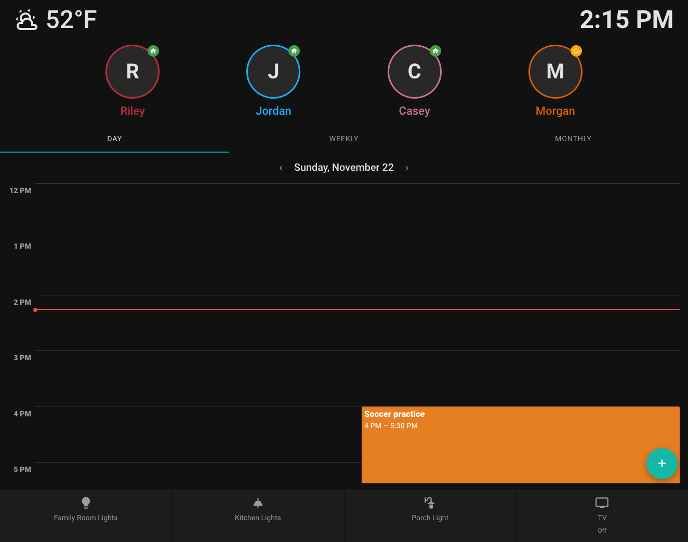
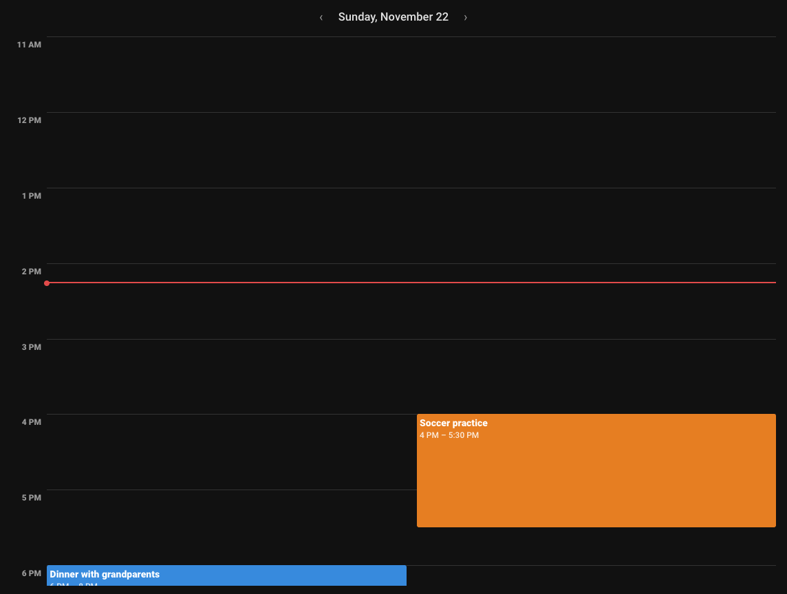
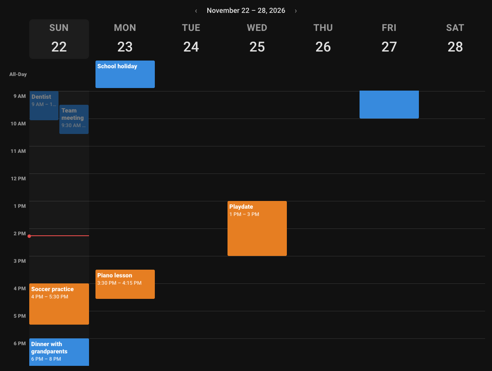
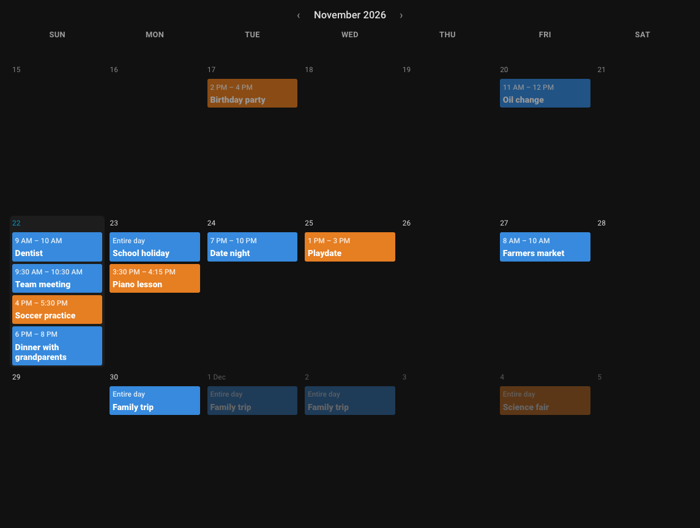

# HearthLike Cards for Home Assistant

Lovelace dashboard cards for a family wall display: a shared calendar with day, week and month views and
quick add/edit/delete.

> **Status:** pre-release. There is no tagged release yet, so HACS can't install it until the first one.

- **Calendar views** — day, week and month, plus a combined card with an add-event button
- **Edit in place** — add, edit and delete calendar events (including recurring ones) from the dashboard
- **All-in-one dashboard card** — weather and clock, people badges, the calendar and quick toggle buttons on one panel view
- **Visual editors** — the cards can be configured from the dashboard UI, and the dashboard card accepts custom CSS

## Screenshots

The all-in-one dashboard card, with weather and clock, people badges, the calendar and quick buttons:



The day, week and month cards on their own:







## Cards at a Glance

_Screenshots will be added with the first release._

| Card | What it does |
|---|---|
| Day (`hearthlike-day-card`) | One day, one column per calendar |
| Week (`hearthlike-week-card`) | Hourly week grid with all-day row and now-line |
| Month (`hearthlike-month-card`) | Month grid with event editing |
| Add event button (`hearthlike-fab-card`) | Floating "+" that creates a calendar event |
| Calendar (`hearthlike-calendar-card`) | Day / Week / Month in a single card with the add button built in |
| Dashboard (`hearthlike-dashboard-card`) | All-in-one wall display for a panel view: weather + clock, people badges, the calendar, and quick toggle buttons |

## Styling the dashboard card

`hearthlike-dashboard-card` follows your theme out of the box. To change it, use any of these:

- **CSS variables** (from a theme, card-mod, or the card's `style` option):
  `--hearthlike-height`, `--hearthlike-background`, `--hearthlike-text-color`, `--hearthlike-header-font-size`,
  `--hearthlike-header-padding`, `--hearthlike-people-gap`, `--hearthlike-people-padding`, `--hearthlike-avatar-size`,
  `--hearthlike-avatar-font-size`, `--hearthlike-ring-width`, `--hearthlike-name-font-size`,
  `--hearthlike-button-background`, `--hearthlike-button-color`, `--hearthlike-button-active-color`,
  `--hearthlike-button-icon-size`, `--hearthlike-button-padding`.
- **The `style` option**: your CSS is applied inside the card and wins over the built-in rules. It is also
  in the visual editor (General tab).

  ```yaml
  type: custom:hearthlike-dashboard-card
  style: |
    :host { --hearthlike-avatar-size: 120px; }
    .clock { color: orange; }
    .btn.on ha-icon { color: hotpink; }
  ```

  Classes: `.header .weather .clock .people .person .avatar .badge .pname .cal .buttons .btn` (with
  `.on`, `.off` or `.unavailable`) `.bname .bstate`.
- **`::part()`** (for a stylesheet in the same tree as the card, which Home Assistant's own shadow DOM usually prevents; the `style` option is the reliable way): `root`, `header`, `weather`, `clock`, `people`, `person`, `avatar`, `badge`,
  `person-name`, `calendar`, `buttons`, `button`, `button-on` / `button-off` / `button-unavailable`,
  `button-icon`, `button-name`, `button-state`.

The CSS variables also work when set from card-mod or a theme, since they inherit into the card.

## Installation

### Via HACS

1. Open **HACS** from the Home Assistant sidebar
2. Open the ⋮ menu → **Custom repositories**, add
   `https://github.com/seanharsh/HA-HearthLike` with type **Dashboard**
3. Search for "HearthLike", select **HearthLike Cards**, then **Download**
4. Restart Home Assistant (or reload the browser) so the dashboard resource is picked up

### Manual

1. Copy `dist/hearthlike-cards.js` into your Home Assistant `config/www/` directory
2. In **Settings → Dashboards → Resources**, add as **JavaScript Module**:
   - `/local/hearthlike-cards.js`

## Requirements

- A recent **Home Assistant** release (the exact minimum version will be documented once tested)
- **Calendar cards**: one or more `calendar.*` entities that support creating and editing events
  (for example [Local Calendar](https://www.home-assistant.io/integrations/local_calendar/))

The day, week and month cards size themselves to their container, so place them in a panel view or a
sections/grid layout with a fixed height. See [`example-dashboard.yaml`](example-dashboard.yaml) for a
complete configuration of every card.

## License

MIT — see [LICENSE](LICENSE).
